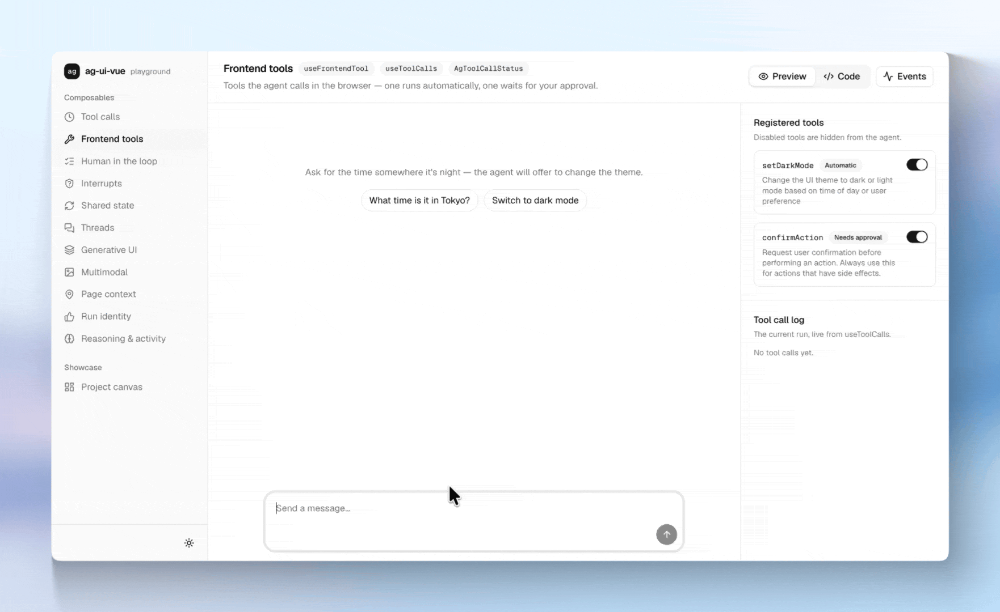
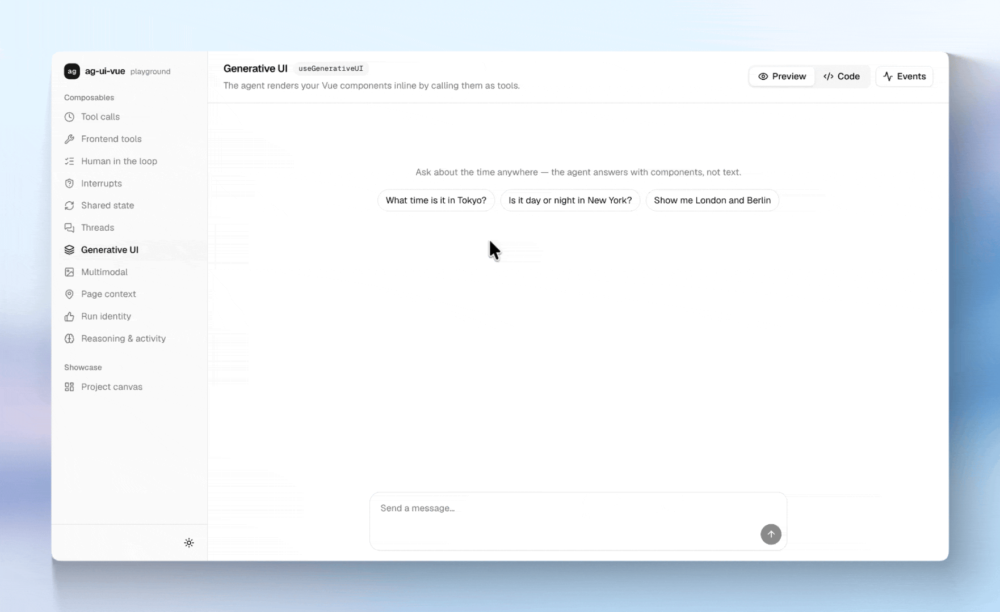
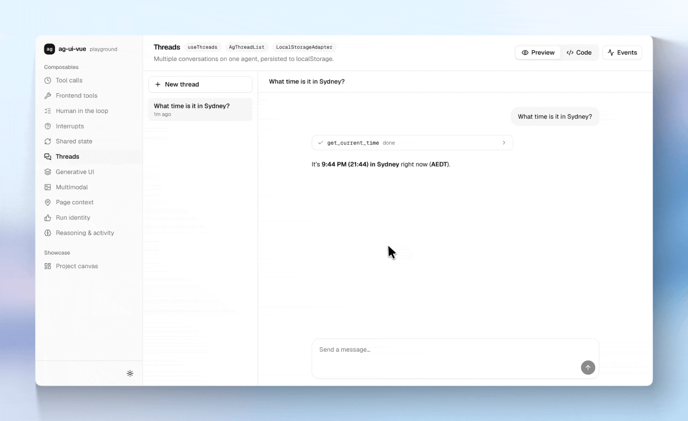
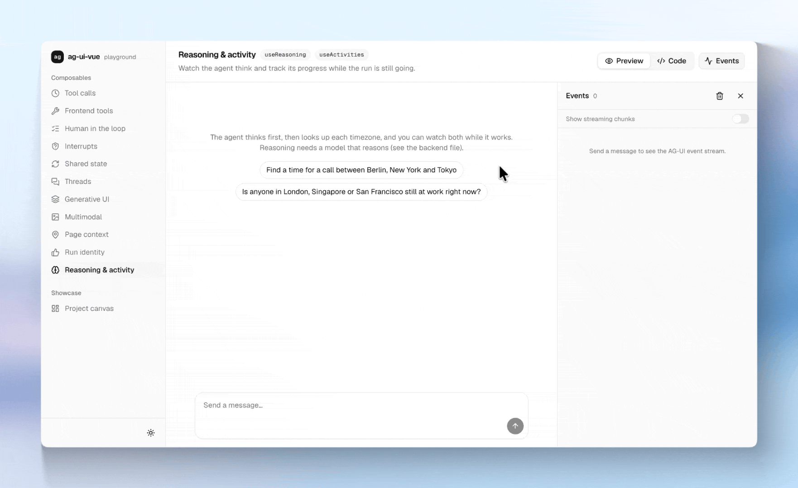

# ag-ui-vue

Agent UIs for Vue. Bring your own backend, keep your own data.

[](https://www.npmjs.com/package/@and-effect/ag-ui-vue)
[](LICENSE)
[](https://github.com/and-effect/ag-ui-vue/actions/workflows/ci.yml)

ag-ui-vue gives you streaming chat, frontend tools, human-in-the-loop approvals and multi-thread history for any agent that speaks the [AG-UI protocol](https://docs.ag-ui.com/).



## Why ag-ui-vue

- **Vue-native.** Built on Vue's reactivity and lifecycle, not ported from React. Shared agent state is a plain reactive object, so `v-model` just works.
- **Any AG-UI backend.** It uses the official `@ag-ui/client`, with no vendor runtime or hosted service in between.
- **Your data stays yours.** Conversations go through a storage adapter you choose: localStorage, in memory, or your own (Pinia, your API).
- **Agents act on your UI.** Frontend tools, approvals, server-side interrupts and generative UI.
- **Headless.** The components render no markup of their own, so they work with Tailwind, Vuetify, Quasar or plain HTML.
- **MIT licensed.** Nothing is held back for an enterprise tier.

## Install

```bash
npm i @and-effect/ag-ui-vue @ag-ui/client @ag-ui/core
```

Requires Vue 3.3 or later. The package is ESM-only, so use a bundler or Node 20.19 or later.

## Quickstart

A complete chat against an AG-UI endpoint. Every element and class is yours; the components only supply the data and the handlers.

```vue
<script setup lang="ts">
import { useAgent, AgMessageList, AgMessageInput } from '@and-effect/ag-ui-vue'

const { messages, streamingContent, isRunning, error, send, abort } = useAgent({
  url: '/api/agent',
})
</script>

<template>
  <AgMessageList :messages="messages" :streaming-content="streamingContent">
    <template #user="{ content }"><p class="user">{{ content }}</p></template>
    <template #assistant="{ content }"><p class="assistant">{{ content }}</p></template>
    <template #streaming="{ content }"><p class="assistant">{{ content }}</p></template>
    <template #empty><p>Ask the agent something.</p></template>
  </AgMessageList>

  <p v-if="error" role="alert">{{ error }}</p>

  <AgMessageInput :is-running="isRunning" @send="send" @abort="abort">
    <template #default="{ value, onInput, onSubmit, onAbort, canSend }">
      <form @submit.prevent="onSubmit">
        <input :value="value" placeholder="Message" @input="onInput" />
        <button v-if="isRunning" type="button" @click="onAbort">Stop</button>
        <button v-else type="submit" :disabled="!canSend">Send</button>
      </form>
    </template>
  </AgMessageInput>
</template>
```

Messages stream in as the agent responds. The [docs](docs/index.md) cover everything else.

## Features

### Chat and agent actions

| | |
| --- | --- |
| [`useAgent`](docs/composables/use-agent.md) | Connects to an AG-UI endpoint and streams messages into reactive refs. |
| [Page context](docs/composables/use-agent.md#page-context) | Tell the agent what the user is looking at. Re-sent on every request, including tool follow-ups. |
| [Multimodal input](docs/composables/use-agent.md#multimodal-messages) | Send images, audio, video and documents alongside text. |
| [`useFrontendTool`](docs/composables/use-frontend-tool.md) | Tools the agent calls in the browser. They run automatically or wait for the user's approval. |
| [`useInterrupts`](docs/composables/use-interrupts.md) | Approve, edit or reject server-side tool calls when a run pauses. |
| [`useGenerativeUI`](docs/composables/use-generative-ui.md) | Renders your Vue components for tool calls, with props streaming in as the arguments arrive. |



With `useGenerativeUI`, the agent's tool calls render as your own components inside the chat.

### Conversations

| | |
| --- | --- |
| [`useThreads`](docs/composables/use-threads.md) | Several persisted conversations on one agent: list, switch, create, delete, auto-generated titles. |
| [Storage adapters](docs/storage-adapters.md) | `LocalStorageAdapter` and `MemoryAdapter` ship with the library. Implement four async methods to store threads anywhere else. |



Switching threads swaps the conversation on the same agent, so tools and subscriptions keep working.

### State and live progress

| | |
| --- | --- |
| [`useAgentState`](docs/composables/use-agent-state.md) | State shared with the agent. Mutate it directly, even with `v-model`, and it syncs both ways. |
| [`useToolCalls`](docs/composables/use-tool-calls.md) | Live status and streaming arguments of every tool call. |
| [`useReasoning`](docs/composables/use-reasoning.md) | The agent's reasoning as it streams, for a "thinking" indicator or panel. |
| [`useActivities`](docs/composables/use-activities.md) | Structured progress updates, such as "checked 3 of 4 registers". |
| [`useAgentEvent`](docs/composables/use-agent-event.md) | Subscribe to any raw AG-UI event, with cleanup when the component unmounts. |

### Production details

| | |
| --- | --- |
| [Token refresh and retry](docs/composables/use-agent.md#token-refresh-and-retry) | An `onError` hook to refresh a token and retry the same run. |
| [Run identity](docs/composables/use-agent.md#run-identity) | Client-owned run IDs, mapped to messages, for feedback and server-side traces. |
| [Outcomes and errors](docs/composables/use-agent.md#run-outcome-and-token-usage) | How the last run ended, its token usage, and machine-readable [error codes](docs/composables/use-agent.md#error-codes). |

### Headless components

| | |
| --- | --- |
| [`AgMessageList`](docs/components.md#agmessagelist) | Renders the conversation through one slot per message type. |
| [`AgMessageInput`](docs/components.md#agmessageinput) | Input state, send and stop, file attachments. |
| [`AgThreadList`](docs/components.md#agthreadlist) | Iterates threads with switch and delete handlers. |
| [`AgToolCallStatus`](docs/components.md#agtoolcallstatus) | One slot per tool call status: running, awaiting result, completed, error. |
| [`AgInterrupt`](docs/components.md#aginterrupt) | One slot per open interrupt, routed by reason, plus a Continue slot. |

See [Limitations](docs/limitations.md) for what is out of scope.

## Backend compatibility

ag-ui-vue talks to your backend only through AG-UI events, so the backend is your choice.

| Backend | Status |
| --- | --- |
| [PydanticAI](https://ai.pydantic.dev/ui/ag-ui/) via `AGUIAdapter` | Tested: the demo backend uses it |
| [LangGraph](https://langchain-ai.github.io/langgraph/) | Expected to work: first-party AG-UI support |
| [Mastra](https://mastra.ai/) via `@ag-ui/mastra` | Expected to work |
| [CrewAI](https://www.crewai.com/) | Expected to work: first-party AG-UI support |
| Any server emitting AG-UI events | Expected to work |



Every interaction is plain AG-UI events, which the demo shows live next to each example.

## Run the demo locally

The playground has one page per feature, backed by a PydanticAI server. You need Node, [uv](https://docs.astral.sh/uv/) and an OpenAI API key.

```bash
git clone https://github.com/and-effect/ag-ui-vue.git
cd ag-ui-vue
npm install
cp examples/backend/.env.example examples/backend/.env   # add your OPENAI_API_KEY
```

Then start the backend and the playground in two terminals:

```bash
npm run dev:backend      # http://localhost:8000
npm run dev:playground   # http://localhost:5173
```

[examples/README.md](examples/README.md) lists every demo, and shows how to run without an API key.

## Contributing

Issues and pull requests are welcome. Please open an issue before starting work; see [CONTRIBUTING.md](CONTRIBUTING.md).

## Security

Please report vulnerabilities privately, as described in [SECURITY.md](SECURITY.md).

## License

[MIT](LICENSE) © &effect data solutions GmbH
